# HarisCommerce

Project katalog produk bikinan aku pakai **React + Vite + React Router**. Data produknya diambil dari public API [DummyJSON](https://dummyjson.com). Bisa cari produk, filter, sorting, lihat detail, masukin keranjang, sampai checkout dan konfirmasi pembayaran.

**Nama:** Muhammad Haris Nur Fadillah
**NIM:** 1247050090
**Link website:** _(isi link website pribadi kamu di sini)_

---

## Cara jalanin

```bash
npm install
npm run dev      # mode development
npm run build    # hasilnya di folder dist/
```

Buat di-hosting, tinggal upload isi folder `dist/` ke website pribadi.

---

## 1. Routing

Pakai **React Router** (client-side), jadi pindah halaman nggak reload full. Tipe routernya `HashRouter`, makanya URL-nya kayak `/#/produk/1`. Aku pilih ini biar aman di hosting statis tanpa perlu setting server.

| URL | Halaman |
| :-- | :-- |
| `/` | Beranda |
| `/produk` | Katalog produk (search, filter, sort, pagination) |
| `/produk/:id` | Detail produk → ini **dynamic route** |
| `/favorit` | Produk favorit |
| `/keranjang` | Keranjang |
| `/checkout` | Isi data pengiriman & pilih metode bayar |
| `/pesanan/:orderId` | Detail pesanan + konfirmasi sudah bayar |
| `/tentang` | Tentang aplikasi |
| `*` | Halaman 404 |

**Nested route:** semua halaman dibungkus `MainLayout` (isinya Navbar + Footer + `<Outlet />`). Khusus `/produk` dan `/produk/:id` ada lagi `ProductsLayout` (breadcrumb) di dalamnya. Navigasinya pakai `Link` dan `NavLink`.

---

## 2. State Management

Ada 5 jenis state yang dipakai:

- **Local state** → `useState` buat hal kecil di satu komponen, misal buka/tutup menu mobile di `Navbar`, isi kolom search di `Toolbar`, dan pilihan foto di halaman detail.
- **Global state** → **Context API** (`context/ShopContext.jsx`) pakai `useReducer`. Isinya keranjang dan favorit, jadi bisa dipakai di semua halaman (Navbar, kartu produk, halaman keranjang, dll). Datanya juga disimpan di localStorage biar nggak ilang pas di-refresh.
- **Server state** → data dari API, diurus hook `useFetch` (ada loading, error, dan tombol coba lagi).
- **URL state** → keyword search, kategori, sorting, dan nomor halaman disimpan di URL (`?q=tas&kategori=laptops&sort=murah&page=2`) lewat `useSearchParams`. Jadi hasil pencarian bisa di-share lewat link dan tetap sama pas di-refresh.
- **Form state** → form catatan dan form checkout, diurus hook `useForm` (controlled component + validasi).

---

## 3. API

Semua pemanggilan API ditaruh di folder `services/`, jadi komponen nggak ngurusin `fetch` langsung.

- `productService.js` → `getProducts()` ambil semua produk dari `https://dummyjson.com/products`, dan `getProductById(id)` buat halaman detail. Harga dari USD dikonversi ke Rupiah (kurs 16.000), terus datanya dirapiin dulu (`normalize`).
- `notesService.js` → simpan catatan/ulasan di localStorage.
- `ordersService.js` → simpan pesanan di localStorage (buat, ambil, dan tandai sudah dibayar).

Tampilan pas ambil data:
- **Loading** → ada spinner
- **Error** → ada pesan error + tombol "Coba lagi"
- **Kosong** → ada pesan "produk tidak ditemukan" (empty state)

Catatan: DummyJSON nggak punya fitur nyimpen data, jadi catatan dan pesanan disimpan lokal di browser, bukan ke server.

---

## 4. Custom Hooks

Semua ada di folder `hooks/`:

| Hook | Fungsinya |
| :-- | :-- |
| `useFetch` | Ambil data dari API, ngasih `data`, `loading`, `error`, dan `retry` |
| `useProducts` | Gabungin data API + URL state: search, filter kategori, sorting, dan pagination |
| `useForm` | Ngurus nilai input, validasi, dan status "sudah disentuh" |
| `useNotes` | Tambah/hapus catatan per produk (disimpan lokal) |
| `useDebounce` | Nahan pencarian 300 ms biar nggak filter di setiap ketikan |

---

## 5. Struktur Folder

```
src/
├─ components/   komponen yang bisa dipakai ulang (Navbar, ProductCard, Pagination,
│                Toolbar, CategoryFilter, Spinner, ErrorMessage, EmptyState,
│                FormField, NoteForm, CartItem, OrderSummary, StatusBadge, dll)
├─ pages/        halaman (Home, Products, ProductDetail, Cart, Wishlist,
│                Checkout, Order, About, NotFound)
├─ layouts/      MainLayout & ProductsLayout (buat nested route)
├─ context/      ShopContext (keranjang & favorit)
├─ hooks/        custom hooks
├─ services/     akses API & localStorage
├─ utils/        fungsi bantu (format Rupiah, dll)
└─ data/         data profil
```

Pembagiannya simpel:
- **Tampilan** → `components/` dan `pages/`
- **Logika** → `hooks/` dan `context/`
- **Akses data** → `services/`

---

## Lampiran Screenshot

### 1. Halaman utama
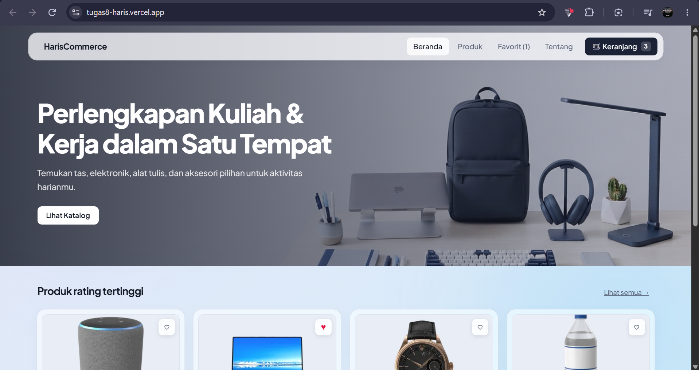

### 2. Detail data (halaman detail produk, `/produk/:id`)
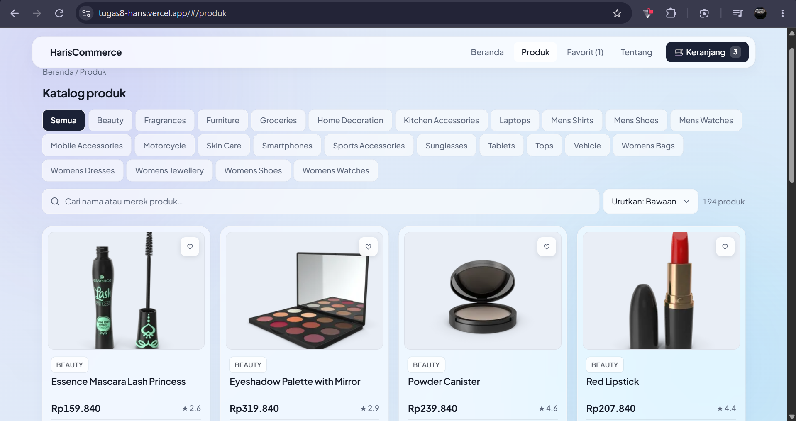

### 3. Halaman utama
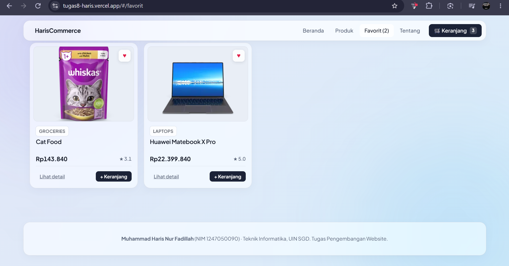

### 4. Fitur interaktif

**Search, filter, sorting, pagination (URL ikut berubah)**
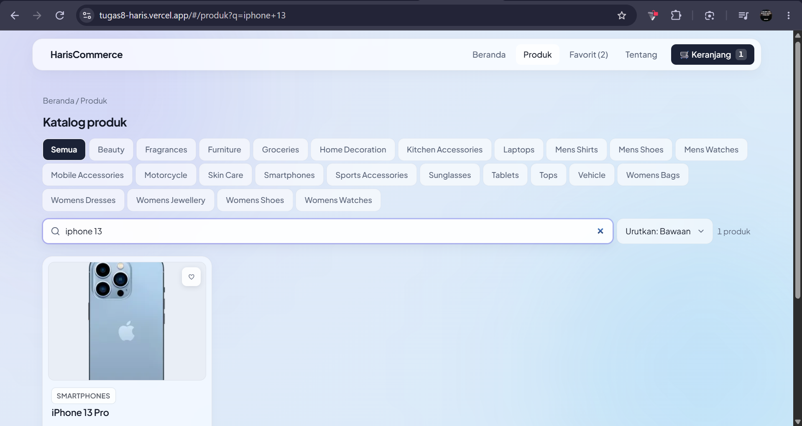
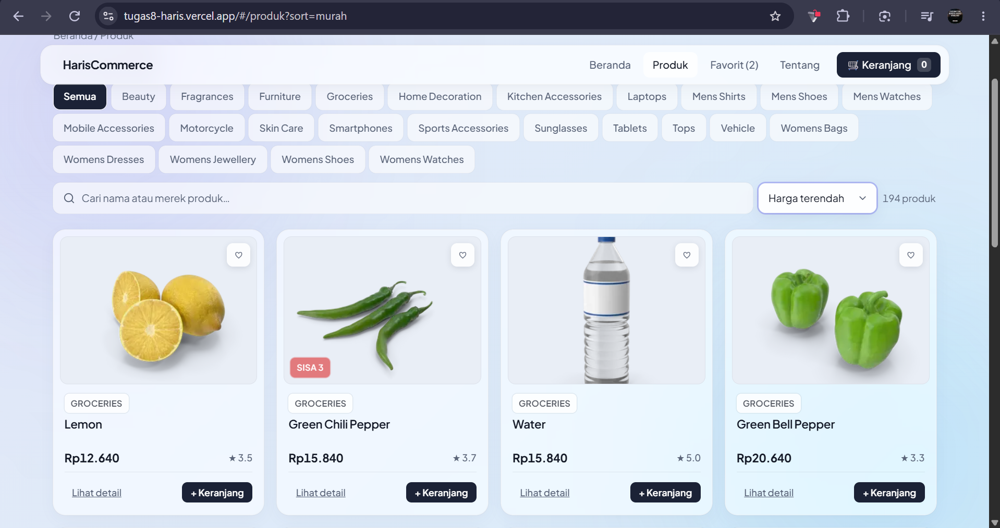
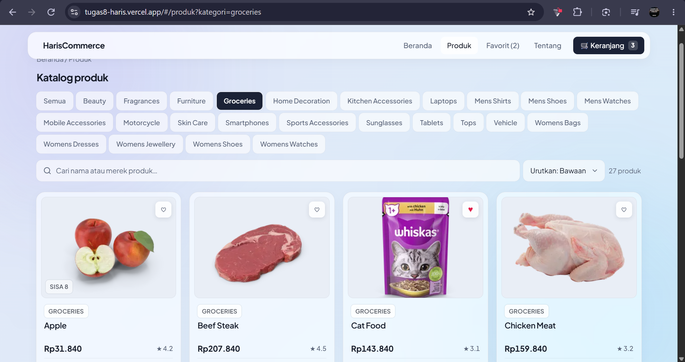

**Form catatan + validasi**
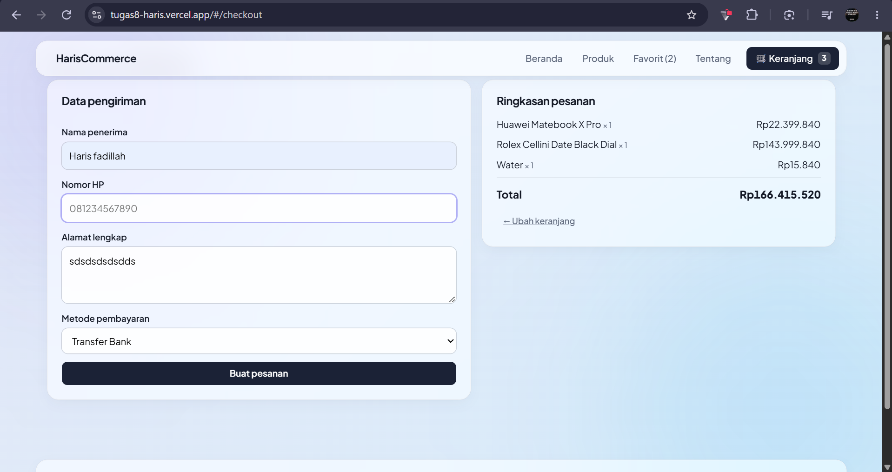
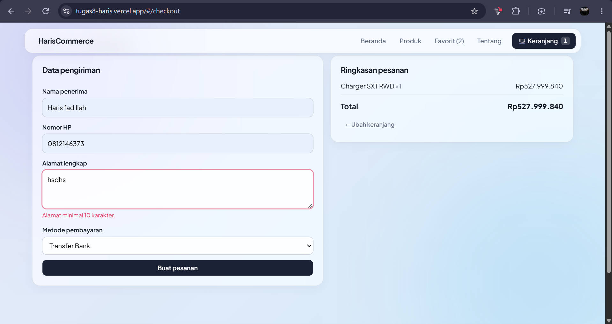

**Keranjang**
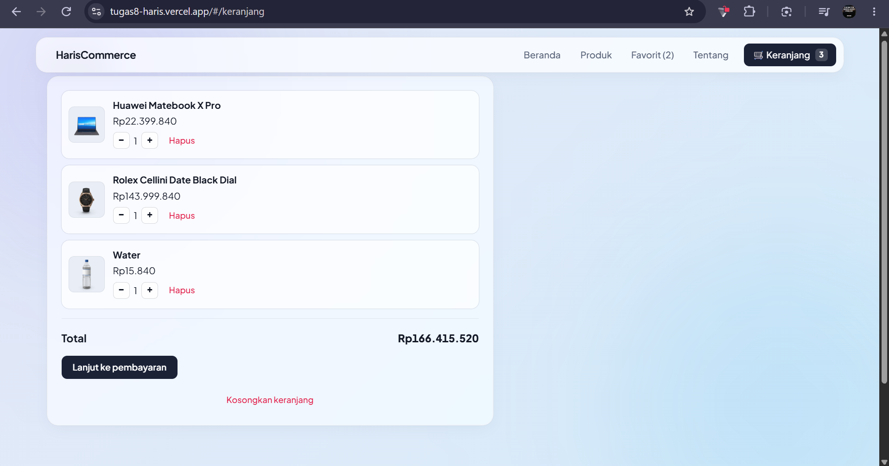

**Checkout**
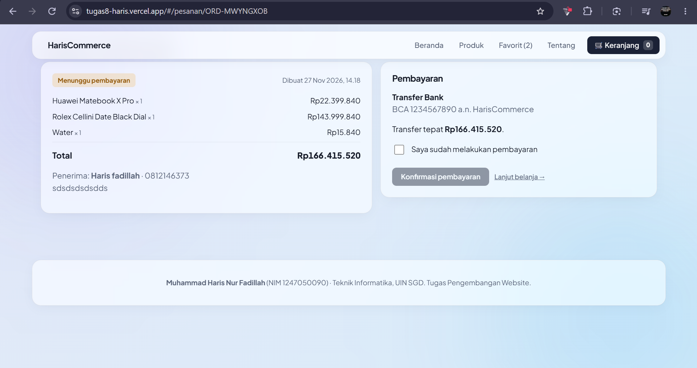

**Konfirmasi pembayaran (centang sudah bayar)**
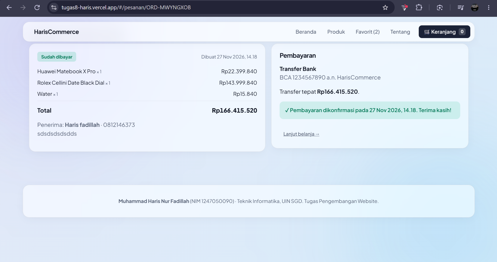

**Bukti commit**
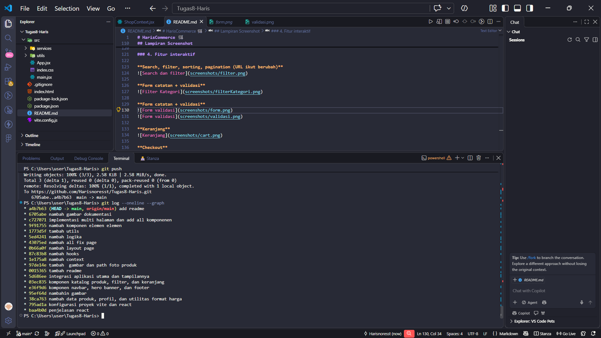